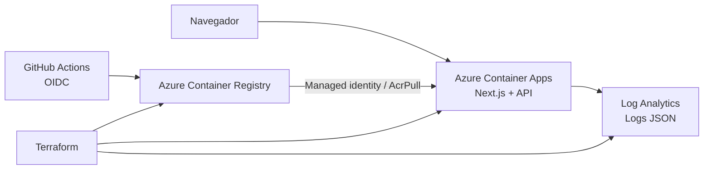

# DevOps Lab · Mission Control

Um laboratório Azure de ponta a ponta: aplicação Next.js/React com shadcn/ui, API instrumentada, Docker, Terraform, GitHub Actions e Container Apps. O painel acompanha a própria API com dados reais do navegador, sem fingir métricas da conta Azure.

## Começar localmente

Requisitos: Node.js 22+, npm e, para containers, Docker Desktop com Linux containers.

```powershell
cd web
npm ci
npm run dev
```

Abra http://localhost:3000. O botão **Executar teste** envia 20 requisições com concorrência 4. A sessão guarda até 120 amostras em memória e permite exportar JSON. Os horários da tabela são UTC.

```powershell
# Na raiz, com o app rodando:
node scripts/smoke.mjs http://localhost:3000
node scripts/load.mjs http://localhost:3000 100 5

# Imagem de produção:
docker compose up --build -d
docker compose ps
docker compose logs -f
docker compose down
```

Pare o servidor npm antes de iniciar o Compose: ambos usam a porta 3000. O teste de carga grava `load-results.json` no diretório atual e retorna falha se houver respostas diferentes de 200. Execute carga apenas nos seus próprios recursos.

No Windows, o build local usa `next start`, evitando restrições de symlinks do formato standalone. No Docker/Linux, o mesmo código gera a saída standalone. Para repetir os testes de interface: `cd web`, `npx playwright install chromium`, `npm run build`, `npm run test:e2e`.

## Arquitetura



- `GET /api/health`: saúde, ambiente, revisão, instância e uptime do processo.
- `GET /api/version`: identificação da aplicação e da revisão.
- `GET /api/work?iterations=1000`: trabalho SHA-256 limitado a 1–20.000 iterações por requisição; entrada inválida retorna 400.
- Cada resposta da API inclui `requestId`, `X-Request-ID`, `Server-Timing` e `Cache-Control: no-store`.
- Logs JSON vão para stdout, coletados pelo Container Apps. As métricas da tela são da sessão do navegador, não agregações do Azure Monitor. O uptime varia conforme a réplica que responde.

## Frontend e shadcn

Criado pelo CLI oficial, sem copiar componentes manualmente:

```powershell
npx shadcn@latest init --name web --template next --defaults --no-monorepo --yes
cd web
npx shadcn@latest add card badge table separator tabs progress alert -y
```

O preset gerado foi `base-nova` (Base UI). O código gerado fica em `web/components/ui`. O layout usa CSS próprio sobre esses componentes. A aplicação não depende de baixar fontes durante o build.

## Infraestrutura Azure

Pré-requisitos: assinatura ativa, Azure CLI autenticada (`az login`), Terraform >= 1.9 e permissão de criar recursos e atribuir o papel AcrPull. O projeto foi validado com Terraform 1.14.0. Se instalado localmente neste laboratório, use `.tools/terraform/terraform.exe` no lugar de `terraform`.

**Antes de provisionar:** confirme a assinatura, a região permitida e o saldo no portal. O vencimento informado é 20/11/2026; planeje exportar dados e remover o laboratório em 19/11. Nenhuma rotina de exclusão automática está habilitada.

```powershell
az account show --query '{name:name,id:id}' -o json
Copy-Item infra/terraform.tfvars.example infra/terraform.tfvars
# Edite subscription_id em infra/terraform.tfvars.
```

O provider não registra serviços automaticamente. Verifique se `Microsoft.App`, `Microsoft.ContainerRegistry`, `Microsoft.OperationalInsights` e `Microsoft.ManagedIdentity` estão registrados. Quando necessário, registre-os explicitamente:

```powershell
az provider register --namespace Microsoft.App --wait
az provider register --namespace Microsoft.ContainerRegistry --wait
az provider register --namespace Microsoft.OperationalInsights --wait
az provider register --namespace Microsoft.ManagedIdentity --wait

terraform -chdir=infra init
terraform -chdir=infra fmt -check
terraform -chdir=infra validate
terraform -chdir=infra plan -out=lab.tfplan
# Revise o plano; o próximo comando cria recursos pagos:
terraform -chdir=infra apply lab.tfplan
terraform -chdir=infra output
```

O primeiro apply usa a imagem pública de quickstart na porta 80 para quebrar a dependência entre criar o registry e publicar a primeira imagem. Ele ainda não publica este painel.

Depois de criar um commit Git, construa a imagem no ACR e gere um segundo plano:

```powershell
$tag = git rev-parse HEAD
./scripts/deploy.ps1 -ImageTag $tag
# Revise e aplique o plano indicado pelo script.
```

O script usa `az acr build`, sem exigir Docker local. Esse build também consome crédito. O segundo plano troca imagem, porta e probes para a aplicação na porta 3000. Após aplicar, **grave `image`, `app_port = 3000` e `revision` em `terraform.tfvars`** com os mesmos valores. Faça isso também após cada deploy/rollback por pipeline antes de aplicar Terraform novamente, evitando que a infraestrutura volte para uma imagem antiga. Não execute Terraform e o pipeline ao mesmo tempo.

O estado fica local nesta primeira versão: **não o envie ao Git**. Guarde backup seguro até remover todos os recursos. Para trabalho em equipe, migre para backend Azure Blob com locking antes de compartilhar a gestão do ambiente.

Se a assinatura limitar o número de ambientes Container Apps e você já tiver um, informe seu ID em `existing_environment_id`. O Terraform apenas referencia esse ambiente; não o altera nem o destrói. Nesse modo, os logs usam a configuração do ambiente compartilhado, e o workspace/cap de 0,1 GB deste laboratório não são criados. O tráfego e os logs do lab podem consumir recursos desse ambiente. O registry continua na região `location`, enquanto a aplicação fica na região do ambiente referenciado.

## CI/CD e OIDC

`Validate` roda em PRs e pushes para `main`: lint, TypeScript, build, imagem Docker e smoke test dentro do container; outro job verifica Terraform. O workflow de deploy é manual e só deve ser usado **após o primeiro deploy da aplicação via Terraform (porta/probes 3000)**.

1. Publique o repositório no seu GitHub e crie o environment `azure-lab`.
2. Crie uma identidade de aplicação no Entra com credencial federada GitHub: issuer `https://token.actions.githubusercontent.com`, audience `api://AzureADTokenExchange`, subject `repo:SEU_USUARIO/SEU_REPO:environment:azure-lab`.
3. Atribua `Contributor` a essa identidade **somente no resource group do lab**. É um escopo inicial de laboratório que permite ACR Tasks e atualização do Container App; refine para papéis personalizados antes de uso em produção.
4. Adicione as variáveis do environment: `AZURE_CLIENT_ID`, `AZURE_TENANT_ID`, `AZURE_SUBSCRIPTION_ID`, `AZURE_REGISTRY_NAME`, `AZURE_RESOURCE_GROUP`, `AZURE_APP_NAME`.
5. Execute `Deploy Azure` na branch `main`. Sem `image_tag`, ele constrói e publica o SHA atual. Para rollback, informe um SHA completo de imagem já existente no ACR.

Não há client secret no repositório. O deploy valida código/build e executa smoke test com revisão esperada ao final. Falha no smoke sinaliza falha do workflow; rollback é manual. Restrinja branches no environment; configure revisão de deploy se seu plano GitHub oferecer esse recurso. O histórico de execuções é visto no GitHub Actions, não inferido pela tela do laboratório.

## Observar e praticar

```powershell
az containerapp logs show -g rg-devops-lab -n ca-devops-lab --follow --tail 50
az containerapp revision list -g rg-devops-lab -n ca-devops-lab -o table
```

No Log Analytics, consulte a tabela `ContainerAppConsoleLogs_CL`:

```kusto
ContainerAppConsoleLogs_CL
| where ContainerAppName_s == "ca-devops-lab"
| extend record = parse_json(Log_s)
| where isnotempty(record.requestId)
| project TimeGenerated, path=tostring(record.path), status=toint(record.status), durationMs=todouble(record.durationMs), requestId=tostring(record.requestId)
| order by TimeGenerated desc
```

Exercícios: publicar dois commits e conferir revisão; gerar carga e comparar p95; procurar um request ID nos logs; fazer rollback; aguardar escala a zero e medir o cold start; remover e recriar a infraestrutura.

## Custos e encerramento

- Container Apps: consumo, 0–2 réplicas, cada uma com 0,25 vCPU / 0,5 GiB. Escala a zero pode causar cold start.
- ACR Basic tem custo recorrente mesmo sem tráfego. Builds, armazenamento e logs também podem cobrar. Escala a zero não zera a conta inteira.
- Log Analytics: retenção 30 dias e cap diário de ingestão de 0,1 GB. O cap não é teto financeiro rígido e pode interromper a coleta.
- Configure orçamento e alertas em Cost Management. Alertas de orçamento não bloqueiam gastos. A tag `expires_on` é informativa.
- Não é necessário gastar todo o crédito para aproveitar o laboratório. Consulte preços na região/assinatura antes do apply.

```powershell
# Exporte evidências, resultados e logs que deseja guardar.
terraform -chdir=infra plan -destroy -out=destroy.tfplan
# Confira o grupo de recursos e os itens no plano antes de executar:
terraform -chdir=infra apply destroy.tfplan
az group exists --name rg-devops-lab
```

O último comando deve retornar `false`. Remova separadamente a identidade de deploy e a credencial federada no Entra, se criadas para esse laboratório. Não dependa da expiração do crédito para guardar os dados.

## Referências

- [CLI oficial shadcn](https://ui.shadcn.com/docs/cli)
- [Cobrança do Container Apps](https://learn.microsoft.com/en-us/azure/container-apps/billing)
- [GitHub Actions com Container Apps](https://learn.microsoft.com/en-us/azure/container-apps/github-actions)
- [Terraform AzureRM](https://registry.terraform.io/providers/hashicorp/azurerm/latest/docs)
- [Expiração da avaliação Azure](https://learn.microsoft.com/en-us/azure/cost-management-billing/manage/avoid-charges-free-account)
